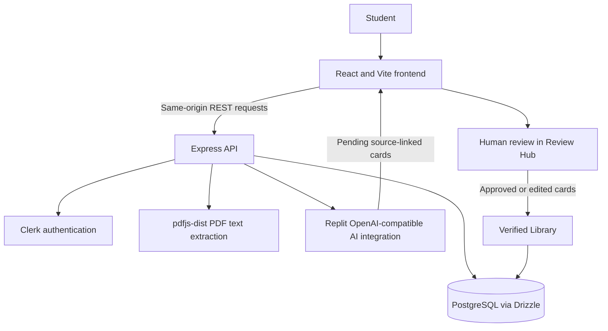

# Study with Miky

**Make knowledge stay.**

Study with Miky turns class notes into source-linked study questions. Learners can start in a guest workspace or sign in with Google, review and edit AI-generated cards, then keep approved cards in a searchable library.

## What it does

Lecture notes are useful only if you return to them. Study with Miky helps make that easier by turning pasted notes or supported files into questions, showing where each question came from, and keeping a person in control of what becomes part of the study library.

## Features

- **Workspace:** paste notes or upload `.txt`, `.md`, `.markdown`, or `.pdf` study material.
- **PDF text extraction:** extract selectable text from PDFs on the server with `pdfjs-dist`.
- **AI study packs:** generate questions, answers, concepts, and exact source excerpts through the Replit OpenAI-compatible AI integration.
- **Review Hub:** approve, edit and approve, or discard each pending card.
- **Verified Library:** search and revisit approved cards.
- **Guest access:** try the workspace without creating an account; sign in with Google through Clerk when an account is preferred.
- **Guest-data transfer:** transfer guest notes to a signed-in, Google-linked account after confirmation.

The standard generation path can fall back to sentence-based demo cards if AI generation or response validation fails. The response indicates whether cards came from AI or demo mode.

## How a study pack moves through the app

1. Paste notes or upload a supported file. The usual PDF workflow extracts text first.
2. Save the note to the current guest or signed-in workspace.
3. Generate cards. The API checks that each source excerpt appears in the note and filters blank and approximate duplicate cards.
4. Review the pending cards. They do not enter the Verified Library until approved.
5. Search and study the approved cards in the library.

## Authentication and data ownership

Google sign-in is handled by Clerk. The API checks the Clerk identity and verifies that the account is linked to Google with a verified primary email before synchronizing the local user record. Google OAuth availability and environment-specific Clerk settings must be configured for the deployment.

Guest workspaces use a signed, HTTP-only cookie backed by a database guest-session row. Notes are queried and changed using the authenticated user or guest identity; clients cannot select another owner. A guest can transfer notes to a Google-linked account after confirmation.

Guest cookies have a browser lifetime, but the current server does not enforce a guest-record expiry or run a cleanup job. Losing a guest cookie may make that workspace inaccessible.

## Technology

- **Web:** React 19, TypeScript, Vite, Tailwind CSS, Wouter, TanStack Query, and Lucide React.
- **API:** Node.js 24, TypeScript, Express 5, REST, and OpenAPI-generated client and Zod schemas.
- **Data:** PostgreSQL, `node-postgres`, Drizzle ORM, and `drizzle-zod`.
- **Authentication:** Clerk with Google sign-in and signed guest cookies.
- **AI:** Replit AI Integrations through the OpenAI SDK; study generation currently requests model `gpt-5.6-luna`.
- **PDFs:** `pdfjs-dist` for selectable-text extraction.
- **Workspace:** pnpm monorepo.

## Architecture



The API is served under `/api`; the web app is served at `/`. Replit's artifact router maps the two services. The API contract lives in `lib/api-spec/openapi.yaml`; Orval generates the React Query client and Zod schemas from it.

## Database overview

| Table | Purpose |
| --- | --- |
| `study_users` | Locally synchronized Clerk user and onboarding data. |
| `study_guest_sessions` | Guest identities and onboarding/transfer state. |
| `study_notes` | Note text and its signed-in or guest owner. |
| `generated_study_cards` | Source-linked cards with pending, approved, or rejected status. |
| `study_library_cards` | Approved card snapshots, including whether a user edited them. |

Cards inherit ownership through their source note. Deleting a note cascades to its generated cards and library snapshots.

## Security and study-input limits

- Study routes scope reads and writes to the current Clerk user or guest session.
- Credentialed CORS is restricted to the same origin and any exact origins configured in `STUDY_TRUSTED_ORIGINS`; state-changing API requests also require the origin check and `X-Study-CSRF` marker.
- JSON request bodies are limited to 1 MiB; URL-encoded bodies are limited to 64 KiB.
- Notes and extracted PDF text are limited to 100,000 characters. PDF uploads are limited to 15 MiB and 250 pages.
- Additional-card generation uses at most 100 existing cards and a 120,000-character context.
- PDF uploads are not OCR-scanned. Image-only or scanned PDFs do not produce text.
- Note text is sent to the configured AI integration when generation is requested. Provider-side retention behavior is not established by this repository.

See [`docs/SECURITY.md`](docs/SECURITY.md) for the focused security review and remaining scanner findings.

## Requirements

- Node.js 24
- pnpm
- PostgreSQL 16 for a standalone local setup
- A Clerk application configured for Google sign-in
- Replit AI Integration settings for the OpenAI-compatible study-generation client

## Run on Replit

The repository includes Replit configuration for Node.js and PostgreSQL, plus separate web and API services. Configure the environment variables below, provision the database and AI integration, then start the configured web and API workflows. Replit routes `/` to the web app and `/api` to the API.

The schema push command below changes the target database. Use it only with a new or disposable development database, not production:

```sh
pnpm install
pnpm --filter @workspace/db run push
```

## Run locally

The application reads configuration from each process environment; the API scripts do not load a `.env` file. Export the required values in your shell or use a local secret manager. Do not commit credentials.

Clone the repository, install dependencies, and check the workspace:

```sh
git clone https://github.com/ShaikShoyab786/Living-Study-Guide-sample.git
cd Living-Study-Guide-sample
pnpm install
pnpm run typecheck
pnpm run build
```

The Replit artifact configuration supplies each service's port and the web base path. For a local launch, run the API and Vite services on separate ports:

```sh
# Terminal 1
PORT=8080 pnpm --filter @workspace/api-server run dev

# Terminal 2
PORT=5173 BASE_PATH=/ pnpm --filter @workspace/living-study-guide run dev
```

The Vite development server does not define a local `/api` proxy. To use the browser app outside Replit, put a same-origin reverse proxy in front of both services and route `/api` to the API port. The app's API client expects same-origin `/api` requests.

For a new local development database, apply the Drizzle schema with:

```sh
pnpm --filter @workspace/db run push
```

This pushes the current schema to the configured database; inspect the target before running it. The repository has no checked-in SQL migration history.

## Environment variables

Set secret values in **Replit Secrets** for a Replit deployment, or inject them into the relevant local process environment. Never put secret values in frontend variables or commit them.

| Variable | Required? | Used by | Purpose and configuration |
| --- | --- | --- | --- |
| `DATABASE_URL` | Yes | API / database | PostgreSQL connection string. Replit PostgreSQL supplies it; provide it to the local API environment for local use. |
| `SESSION_SECRET` | Yes | API | Signs guest-session cookies. Set as a backend secret. |
| `AI_INTEGRATIONS_OPENAI_API_KEY` | Yes | API | Credential read by the Replit OpenAI-compatible AI client. Provision through the Replit AI Integration and keep server-side. |
| `AI_INTEGRATIONS_OPENAI_BASE_URL` | Yes | API | Base URL read by that AI client. Provision through the Replit AI Integration and keep server-side. |
| `VITE_CLERK_PUBLISHABLE_KEY` | Yes | Frontend | Clerk publishable key; the app stops if it is missing. Configure it in the web build environment. It is public, not a secret. |
| `CLERK_SECRET_KEY` | Required for Google account sync; required to enable the production Clerk proxy | API | Server-side Clerk credential. Store only in backend Secrets/environment. Without it, signed-in user lookup and the production proxy are unavailable. |
| `CLERK_PUBLISHABLE_KEY` | Optional fallback | API | Fallback publishable key for server Clerk middleware when host-based key resolution is not sufficient. Configure in the backend environment if needed. |
| `VITE_CLERK_PROXY_URL` | Optional | Frontend | Clerk Frontend API proxy URL when the deployment uses the API's `/api/__clerk` proxy. Configure in the web build environment. |
| `STUDY_TRUSTED_ORIGINS` | Optional | API | Comma-separated, exact additional origins for a separate frontend origin. Same-origin requests are allowed by default. |
| `LOG_LEVEL` | Optional | API | Pino log level; defaults to `info`. |
| `PORT` | Required at runtime | API and web | Listening port. Replit supplies a distinct value to each service; set one per process locally. |
| `BASE_PATH` | Required by Vite | Web | Frontend mount path. Replit sets `/`; set it to `/` for the local Vite example above. |
| `NODE_ENV` | Runtime-managed | API and web | Controls development/production behavior. The API dev script sets `development`; Replit sets production for deployed services. |
| `REPL_ID` | Optional, Replit development only | Web | Enables Replit's development-only Vite plugins. Replit supplies it when applicable. |

## Tests and checks

```sh
pnpm run typecheck
pnpm --filter @workspace/api-server run test:security
```

The checked-in security tests focus on same-origin, trusted-origin, and CSRF behavior. This repository does not currently provide a full end-to-end test suite for Google sign-in, guest transfer, PDF upload, and AI generation.

## Current limitations and future work

- Scanned/image-only PDFs need OCR, which is not implemented.
- Guest records do not have server-enforced expiration or scheduled cleanup.
- PDF extraction is not rate limited and does not yet have parse-concurrency controls.
- AI generation has per-owner request limits, but does not yet have a shared multi-instance limiter or global spend ceiling.
- Generated card count and output-field lengths do not have separate caps.
- Account deletion is not synchronized from Clerk to local records.
- Broader authenticated integration and end-to-end tests remain to be added.
- Dependency scanner findings and their reachability assessment are documented in [`docs/SECURITY.md`](docs/SECURITY.md).

## Project documentation

- [Architecture](docs/ARCHITECTURE.md)
- [Authentication and authorization](docs/AUTHENTICATION-AND-AUTHORIZATION.md)
- [AI question generation](docs/AI-QUESTION-GENERATION.md)
- [Database](docs/DATABASE.md)
- [Security review](docs/SECURITY.md)

## Author

Project author: [@ShaikShoyab786 on GitHub](https://github.com/ShaikShoyab786) · [LinkedIn](https://www.linkedin.com/in/sshoyab/)
